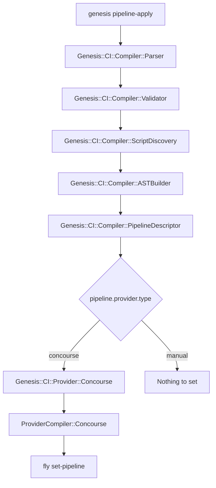

# CLI Commands

Genesis provides `genesis propagate` and a family of `pipeline-*` commands for working with CI pipelines, along with seven retired ones: three v2 commands that predate them, and four that ran inside a legacy Concourse task. This document covers all of them.

Where a command refuses, it exits with a code from `Genesis::Exit` rather than with a bare number, so a pipeline job can tell a refusal from a partial result from a crash. The refusals on this page exit `CONFIG`. A fatal system error exits a bare 1, a usage or option error exits 2, and the prerequisites check exits 86, all three being Genesis precedent that predates the table.

## genesis pipeline-apply

The `pipeline-apply` command gives the pipeline its shape. It compiles a CI pipeline definition and, where the provider has one to set, deploys it to the CI platform.

```
genesis pipeline-apply [options]
```

`genesis repipe`, the v2 name for this command, is retired in 3.2 and refuses, naming `pipeline-apply` (see [The v2 commands retired in 3.2](#the-v2-commands-retired-in-32)).

`pipeline-apply` compiles the pipeline your repository configures and uploads it to the CI system that pipeline names, through `fly set-pipeline` where that system is Concourse. It prompts for confirmation before uploading unless you pass `--yes`. The configuration is the `pipeline:` section of `.genesis/config`, and the provider is read from `pipeline.provider.type` rather than from any flag.

There is no fallback to `ci.yml`. A repository whose `pipeline:` section is absent or not enabled has no pipeline to apply, and `pipeline-apply` says so instead of compiling anything. A repository that still carries a `ci.yml` with a top-level `pipeline:` key is refused earlier still, by a check that names the migration and exits `Genesis::Exit::CONFIG`, so no pipeline command reads that file.

A deployment root has one pipeline, so the command takes no layout. A layout name given as a positional argument, a leftover of `ci.yml`'s `layouts`, is accepted and ignored.

The apply runs from `control`, committed and in step with the remote, and does its work in this order:

1. Writes the secrets it owns:
   - the pipeline's webhook token, where `pipeline.provider.git.webhooks` is on;
   - each tracked director's credentials, copied from the director's exodus record, where an environment sets `genesis.pipeline.track_bosh_configs`.
2. Checks every other `((name.key))` the pipeline references where Concourse will look for it, reporting each as found, missing or unverified, never with its value. A missing one refuses the apply.
3. Cuts the deployment branches.
4. Sets the branch rulesets and the GitHub push hook, where `GITHUB_AUTH_TOKEN` allows it.
5. Writes the applied record.
6. Sets the pipeline.

Each write is reported as new, changed, or already in place, so a second run changes nothing that already stands.

### Options

`--yes` or `-y` skips the `fly set-pipeline` confirmation prompt. This is useful for automation.

`--dry-run` or `-n` generates the pipeline YAML and prints it to stdout without deploying to Concourse. Combine this with output redirection to save the generated YAML for review.

`--target` or `-t` names the fly target to apply through for this run (as shown by `fly targets`). A target is an entry in one operator's `~/.flyrc`, so none is read from `.genesis/config`, which names the Concourse by its `url` and `team` instead. Without `--target`, the target is this clone's own pin, set with `git config genesis.fly-target <target>` (in the clone's `.git/config`, never globally), or else the one `~/.flyrc` target whose URL and team are the configuration's. Two such targets are refused, naming both; none is refused with the `fly login` that makes one. The apply asks for the target before it writes anything.

`--paused` or `-P` keeps the pipeline paused after uploading. By default, Genesis unpauses the pipeline after a successful `set-pipeline`.

`--output-dir` or `-o` writes compiled pipeline artifacts to a directory instead of deploying. This produces the pipeline YAML, an `ast.json` file containing the full AST, and any other provider output files.

`--skip-vault` reads and writes no vault. The secret check reports every reference unverified rather than found or missing, and neither the webhook token nor a director's credentials is written. It suits a local look at the generated YAML.

`--missing-secrets-ok` sets the pipeline even where a secret it references is found nowhere Concourse would look, as for a first apply whose secrets are published afterwards. The check's report is printed either way.

`--rotate-webhook-token` replaces the pipeline's webhook token, and the GitHub hook that carries it, in the same run. It applies only where `pipeline.provider.git.webhooks` is on.

`--cleanup-orphans` removes what the pipeline left for each orphaned environment: one whose file has left control while its branch remains. Every apply reports these environments and what each left behind: its branch, its pull request branch and any open pull request, its protection ruleset and its records under the pipeline's vault mount. An environment that is still deployed is named with a warning; restore its file from its branch and run `genesis <env> terminate`, since the cleanup never touches a deployment. With this flag the apply asks before removing anything, unless `--yes` is given: it comments on and closes the open pull request, deletes the ruleset and both branches, and clears the records. A removal that fails, such as a ruleset the token cannot administer, is reported and the rest proceed. With `--dry-run` it says what it would remove.

`--debug-dir` writes intermediate compiler artifacts to a directory for debugging. The artifacts are numbered by compilation stage:

```
01-parsed.json        # Parser output
02-ast-source.json    # AST source representation (Genesis concepts)
03-pipeline.json      # Resolved generic pipeline (resource_types, resources, jobs, groups)
04-pipeline.dot       # Graphviz DOT source
05-description.txt    # Human-readable description
06-output-pipeline.yml # Final provider output
```

### Examples

Compile and deploy the pipeline:

```bash
genesis pipeline-apply
```

Preview what is generated without deploying:

```bash
genesis pipeline-apply --dry-run > pipeline.yml
```

Write all compiler artifacts to a directory for inspection:

```bash
genesis pipeline-apply --output-dir ./debug --skip-vault
```

Dump every intermediate stage of compilation:

```bash
genesis pipeline-apply --debug-dir ./stages --skip-vault
```

The provider is whichever type `pipeline.provider.type` names. Concourse is the only one Genesis can compile for today. The `github-actions` type validates and resolves on the CLI side, but it has no compiling class yet, so a repository set to it is told so rather than being given a pipeline. The `manual` type has no pipeline to set at all, and the command says which stage it skipped and exits successfully.

## genesis propagate

Walks the control branch forward and delivers each due commit to the deployment branches that are ready for it.

```
genesis propagate [options]
```

The run takes no environment argument. It walks control forward from every deployment branch's newest marker and routes each commit on its own, in control order. A commit is delivered to an environment when nothing upstream of it is still waiting to deploy the files that commit touches, and is held with its reason when something is. The run switches to the control branch inside its own session and leaves you on the branch you started on.

Before anything moves, the run reads the remote once and asks every question it depends on: your working tree, the remote itself, the applied record, control's standing against the remote, whether the pipeline is enabled, the provider, the pull request branches, every deployment branch's state, and the pull request reviews. Where any of them fails, it refuses once, naming every problem it found, at the most serious exit code among them, and nothing in your clone has moved, not even the remote-tracking refs. A question that cannot be answered because an earlier one failed, such as everything read from control when control has moved under you, is named as not checked. Only a run that finds nothing brings what it read into the remote-tracking refs, creates the branches it needs, and walks.

A pipeline that is not enabled is refused at `CONFIG`. Where `pipeline-apply` has applied it, the refusal is the disowned pipeline's; where it never has, the refusal names `pipeline.enabled`. A control branch whose configuration has no `pipeline` section is refused before the remote is read at all.

### Options

`--dry-run` or `-n` reports what each environment would receive, per control commit, and writes nothing. It asks the same questions and refuses the same way. It brings the remote-tracking refs up to what it read of the remote, so it previews exactly what a run would read, but it creates, resets, and fast-forwards no branch. Each move a run would make before it walks is named as one the preview assumes: an unpushed control commit, a marker-only commit a run would reset, a branch a run would fast-forward, and a branch a run would create. With control ahead of the remote, the preview reads the pipeline as your unpushed control has it. The preview switches no branch: it reads control's commits from git, so it runs from any branch, and a clone with no local control branch previews control as the remote has it. Because propagation delivers commits, a change in the deployment root must be committed, though not pushed, before a preview can show it; changes in other deployment roots of the same repository do not matter to it.

`--yes` or `-y` publishes without asking. The verified delta for every environment is shown either way.

`--force` propagates by hand under a pipeline that owns the work. At a terminal you are still asked to confirm, and outside one the refusal stands.

## genesis pipeline-status

Reports where every environment of this deployment root stands.

```
genesis pipeline-status [options]
```

Each environment carries one reading of whether what its branch holds has been deployed, and the routing the walk decided stands beside it, so this command and `genesis propagate` can never disagree about what is held and why.

The command reads the remote once and brings the remote-tracking refs for control and the deployment branches up to it. It creates no local branch, moves no branch you have, and leaves a pull request branch's remote-tracking ref where the last publish put it. It reports control as the remote holds it, whatever branch you stand on: every environment is read from control's own files, with the same load a propagate makes, never from your working tree, and an unpushed control commit is not in effect. Where the remote cannot be reached it fails at `TEMPFAIL`, naming the network, and `--no-refresh` is the way to report without it.

The command takes no lock, so it never makes a propagate fail. Where a propagate in this clone is running, it leaves the remote-tracking refs to that run, reads them as the run left them, and says the run is in progress. While that run stands on a deployment branch to deliver to it, your working tree has no deployment root to read, so the status refuses at `TEMPFAIL`, naming the run, and says to run it again once the run finishes or from another clone.

### Options

`--no-refresh` reports from the remote-tracking refs this clone already has, without reading the remote. The header then says the report is stale, the routing summary and the divergence cell are marked unverifiable, and every reading that rests on those refs alone is qualified where it is printed. This is the only command that takes the option.

`--json` emits the canonical status record instead of the tree. The tree renders the same record, so the two never disagree.

## genesis pipeline-hold

Holds propagation to an environment until somebody releases it.

```
genesis prod pipeline-hold "waiting on the capacity report"
genesis pipeline-hold "freezing the fleet for the audit"
```

The reason is required. With an environment named it holds that one, and without one it holds every environment in the deployment root. While the hold stands, `genesis propagate` delivers nothing new to the environment and opens or updates no pull request, and everything already on the deployment branch stays deployable. The run's report and `genesis pipeline-status` both show `held, needs clearing` with the reason, whether or not anything is due.

A control commit can set the same hold for itself with a `Genesis-Stage: hold: <reason>` trailer, and the run writes the record when it delivers that commit, so the deploy of it finds the hold already standing. A commit whose gate the control branch has since released is delivered as an ordinary commit and sets no hold, because the reason travels with the gate and a released gate carries none.

## genesis pipeline-release

Clears the hold, so the next `genesis propagate` delivers to the environment again.

```
genesis prod pipeline-release
genesis pipeline-release
```

Releasing is a human act. No deploy clears a hold, and no flag does either. The record is deleted outright and no released-by fields are kept, so the release lives in the command's log line.

## genesis pipeline-graph

Compiles the pipeline and prints a Mermaid flowchart, or writes it to the file `--output` names. A file written inside the deployment root is an uncommitted change, which `pipeline-apply` refuses until it is committed.

```
genesis pipeline-graph
```

It replaces the retired `genesis graph`, which drew the v2 topology through Graphviz. It is a preview, as `pipeline-describe` describes.

## genesis pipeline-describe

Compiles the pipeline and prints an ordered environment progression with gate and trigger annotations.

```
genesis pipeline-describe
genesis pipeline-describe --from origin/control
```

It resolves the repository's own configuration out of files, so it holds no ref a refresh could make current and it takes no refresh flag. It replaces the retired `genesis describe`.

Like `pipeline-graph` and `pipeline-apply --dry-run`, it is a preview: it reads the deployment root's working tree, so a change can be checked before it is committed. Where that tree differs from control on the remote, a banner says how, one line per difference: uncommitted changes assumed committed, unpushed commits assumed pushed, commits on the remote the tree lacks, or a branch other than control assumed merged. `--from <ref>` previews any commit instead, such as `origin/control` for what a real apply would set now.

## genesis pipeline-diff

Compiles the pipeline and compares it against the live pipeline fetched through `fly get-pipeline`.

```
genesis pipeline-diff [options]
```

It shows each path that differs, through `spruce diff`, or reports that the two pipelines are identical; key order and how a null is spelled are never differences. Like `pipeline-describe` it is a preview: it compiles the working tree, and `--from <ref>` compiles a commit instead. `--target` or `-t` names the fly target for the run, found otherwise as `pipeline-apply` finds it, and `--skip-vault` skips vault connectivity when compiling.

## The Provider Job Controls

Three commands reach past the compiled pipeline to the jobs the provider is running. All three are Concourse-only today, all three take `--target` or `-t` and `--skip-vault`, and all three take an optional environment name.

`genesis pipeline-jobs [<env>]` queries `fly jobs` and displays the status of each environment's deployment job. Pass an environment name to filter to a single job.

`genesis pipeline-pause [<env>]` pauses the named environment's job through `fly pause-job`. With no environment named it pauses the entire pipeline instead.

`genesis pipeline-resume [<env>]` resumes the named environment's job through `fly unpause-job`. With no environment named it resumes the entire pipeline instead.

These three are about the provider's jobs and not about propagation. To stop delivering to an environment, use `genesis pipeline-hold`, which is the one that `genesis propagate` and `genesis pipeline-status` both read.

## The v2 commands retired in 3.2

Three v2 commands sat outside the `pipeline-*` family. None of them works in Genesis 3.2, whose pipeline comes from the `pipeline` section of `.genesis/config` rather than `ci.yml`. Each stays registered only to refuse, whatever it is given, and to name its replacement, and its help says the same.

| v2 command | Use instead |
|---|---|
| `genesis repipe`, and its alias `genesis push` | `genesis pipeline-apply` |
| `genesis graph` | `genesis pipeline-graph`, a Mermaid flowchart rather than Graphviz |
| `genesis describe` | `genesis pipeline-describe` |

A script that called one of them stops with that pointer. A layout argument or `--config` has no counterpart, since a deployment root has one pipeline.

## Retired Pipeline Commands

Four commands once ran inside a legacy Concourse task. All four are retired and none of them runs any more. `genesis ci-pipeline-deploy` authenticated to Vault with AppRole credentials from the environment, loaded the Genesis environment, deployed it, and committed the state files back to the repository. `genesis ci-show-changes` asked the BOSH director what a deployment would change, so that a notification job could show an operator what was pending before they approved it. `genesis ci-generate-cache` wrote the cache of shared configuration that downstream environments used to watch, which the deployment branches replaced. `genesis ci-pipeline-run-errand` ran a BOSH errand after a deployment. Each of the four is still registered in `bin/genesis` so that dispatch refuses it by name, which makes a legacy pipeline fail loudly rather than deploy something inconsistent. They are described here, in one place, so that a reader who meets one in an old pipeline knows what it did.

## What landed after the MVP

`genesis pipeline-hold` and `genesis pipeline-release` are the first entries on this list, and they arrived after the MVP rather than with it. The MVP shipped the propagation hold's record path, the outcome words that carry a hold's qualifier, and the readers that report one, and it shipped no way to set or clear a hold by hand. Nothing else was rebuilt when they arrived.

## Code Path Summary


